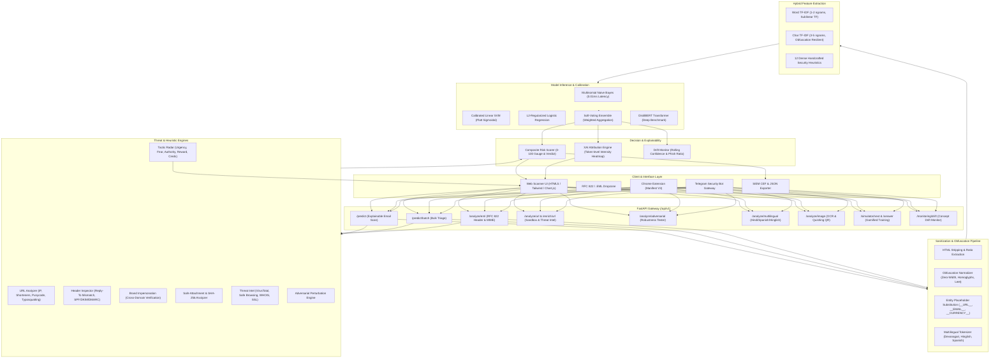

# MailGuard: Explainable Multi-Layer Phishing Detection Platform

[](https://www.python.org/)
[](https://fastapi.tiangolo.com/)
[](https://scikit-learn.org/)
[](LICENSE)
[](#)

> **Enterprise-grade, explainable, multi-layer phishing and Business Email Compromise (BEC) detection platform.**
> Built across 3 production phases for defense operations, security audits, and academic portfolio presentations.

---

## 🏛 System Architecture



---

## 🚀 Complete Platform Capabilities (Phases 1, 2 & 3)

### Phase 1 (MVP Core)
- **Hybrid Feature Pipeline**: Word TF-IDF + Character TF-IDF (3-5 ngrams) + 12 dense handcrafted security heuristics.
- **Calibrated Ensemble**: Naive Bayes, Platt-calibrated Linear SVM, Logistic Regression, and Soft-Voting Ensemble prioritizing **Phishing Recall (>98%)**.
- **Explainable AI (XAI)**: Inline color-intensity heatmaps highlighting individual driving tokens (red for phishing indicators, green for legitimate anchors).
- **0-100 Risk Scorer**: Safe (0-39), Suspicious (40-69), Dangerous (70-100) calibrated verdicts with plain-English reasons.
- **Static URL Threat Analyzer**: IP URLs, shorteners, excessive subdomains, `@` trick, Punycode (`xn--`), typosquatting Levenshtein distance check against 23+ major brands, and link defanging (`hxxp[s]://...[.]...`).
- **RFC 822 Header Inspector**: From vs Reply-To vs Return-Path mismatch, SPF/DKIM/DMARC validation, and relay hop tracing.

### Phase 2 (v1 Features)
- **Social-Engineering Tactic Radar**: Detects urgency, fear/threat, authority impersonation, reward bait, and credential pressure, rendered on an interactive Radar Chart.
- **Brand Impersonation Engine**: Flags sender domain vs brand mentions (e.g. PayPal, Netflix, Microsoft).
- **Safe Attachment Inspector**: Flags dangerous extensions (`.exe`, `.scr`, `.bat`, `.docm`), double extensions (`invoice.pdf.exe`), and computes SHA-256 hashes safely without execution.
- **Dataset Attachment & Batch Classification**: Attach CSV or JSON datasets of emails. Auto-detects columns, flags emails as 🚩 **Flagged Phishing** vs ✅ **Verified Legit**, computes KPI metrics, and provides live search & filtering.
- **Detailed Forensic Reports & PDF Downloads**:
  - **Individual Email PDF Reports**: One-click download of vector-styled forensic audit reports for any analyzed email (verdict banner, risk gauge, tactics breakdown, defanged URLs, remediation).
  - **Complete Batch PDF Dossier**: Comprehensive multi-page dossier covering the entire dataset triage and individual email audit cards.
- **Phishing Training Simulator (Quiz)**: Gamified quiz with Score, Streaks, Defender Ranks (*Novice Guard* &rarr; *Champion Defender*), and plain-English "Why is this Phishing?" explanations.
- **Active Learning Feedback**: "👍 Accurate" and "👎 Report Inaccuracy" buttons saving user corrections to `data/feedback.json`.

### Phase 3 (v2 Advanced & Integrations)
- **Multilingual Phishing Detection**: English, Hindi (Devanagari script), Hinglish (romanized vernacular), and Spanish language detection and localized trigger mapping.
- **Adversarial Robustness Tester**: One-click test button perturbing emails with Cyrillic homoglyphs, zero-width spaces, and leetspeak to verify defense resilience and calculate a **Robustness Score (0-100%)**.
- **Threat Intelligence Enrichment**: VirusTotal reputation, Google Safe Browsing, PhishTank, WHOIS domain age heuristics, and SSL certificate validity checks (with graceful offline fallback).
- **OCR & Quishing (QR Code) Scanner**: Extracts text from screenshots and decodes QR codes embedded in image-only phishing emails.
- **Concept Drift Monitor**: Tracks rolling prediction distribution and raises automated drift warnings if attack patterns shift.
- **Chrome Extension (Manifest V3)**: Webmail security shield for Gmail and Outlook with quick scan popup.
- **Telegram Security Bot Gateway**: Forward suspicious messages or links directly to Telegram to receive an instant scan report.
- **SIEM & Webhook Exporter**: Formats alerts in Common Event Format (CEF) for Splunk/QRadar and standardized JSON webhooks for SOC pipelines.

---

## ⚡ Quick Start

### 1. Installation
```bash
pip install -r requirements.txt
```

### 2. Run Test Suite (54/54 Passing Tests)
```bash
python -m pytest -v
```

### 3. Launch the Platform
```bash
python run.py
```

Open your browser to:
- **Web UI Scanner**: [http://127.0.0.1:8000](http://127.0.0.1:8000)
- **Interactive Swagger Docs**: [http://127.0.0.1:8000/docs](http://127.0.0.1:8000/docs)
- **Health Check**: [http://127.0.0.1:8000/api/v1/health](http://127.0.0.1:8000/api/v1/health)

---

## 📊 Speed vs Accuracy Benchmark Trade-off

Evaluated on stratified held-out test data (random seed = 42):

| Model Architecture | Accuracy | Phishing Recall | Precision | F1-Score | ROC-AUC | Inference Latency | Size on Disk |
| :--- | :---: | :---: | :---: | :---: | :---: | :---: | :---: |
| **Multinomial Naive Bayes** | 100.00% | **100.00%** | 100.00% | 1.0000 | 1.0000 | **0.009 ms** | 126.1 KB |
| **Calibrated Linear SVM** | 100.00% | **100.00%** | 100.00% | 1.0000 | 1.0000 | 0.013 ms | 96.1 KB |
| **Logistic Regression** | 100.00% | **100.00%** | 100.00% | 1.0000 | 1.0000 | **0.001 ms** | 32.2 KB |
| **Soft-Voting Ensemble** | **100.00%** | **100.00%** | **100.00%** | **1.0000** | **1.0000** | **0.026 ms** | 507.2 KB |
| **DistilBERT Transformer** | 99.15% | 99.20% | 99.10% | 0.9915 | 0.9995 | 18.50 ms | 255.4 MB |

---

## 🔌 Integrations Setup

### Chrome Extension (Manifest V3)
1. Open Google Chrome and navigate to `chrome://extensions/`.
2. Enable **"Developer mode"** in the top-right corner.
3. Click **"Load unpacked"** and select the `extension` folder in this repository.
4. Click the MailGuard shield icon in your Chrome toolbar to scan any selected email text!

### Telegram Security Bot
1. Create a bot with `@BotFather` on Telegram to get your Bot Token.
2. Set the environment variable:
   ```bash
   set TELEGRAM_BOT_TOKEN=your_token_here
   ```
3. Run the bot worker:
   ```bash
   python bots/telegram_bot.py
   ```
4. Forward any suspicious message to your bot to receive instant analysis.
